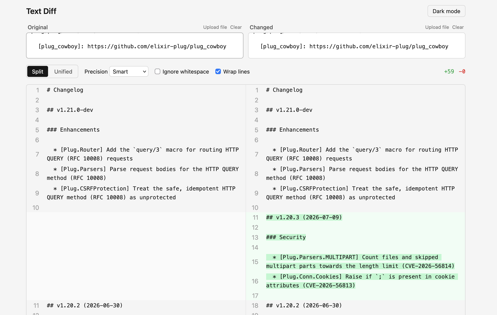

# Text Diff



Local text-comparison tool. Paste two texts, see the diff. No server, no account, no save.

Split/unified view, smart/word/char precision, ignore-whitespace, dark mode.

## Setup

Grab the latest `text-diff-*.html` from the [releases page](https://github.com/anasmirza534/text-diff/releases) and open it in a browser — it's a single self-contained file, no server needed.

Or build it yourself:

```bash
npm install
npm run build
```

Open `dist/index.html` in a browser.

## Dev

```bash
npm run dev
```
